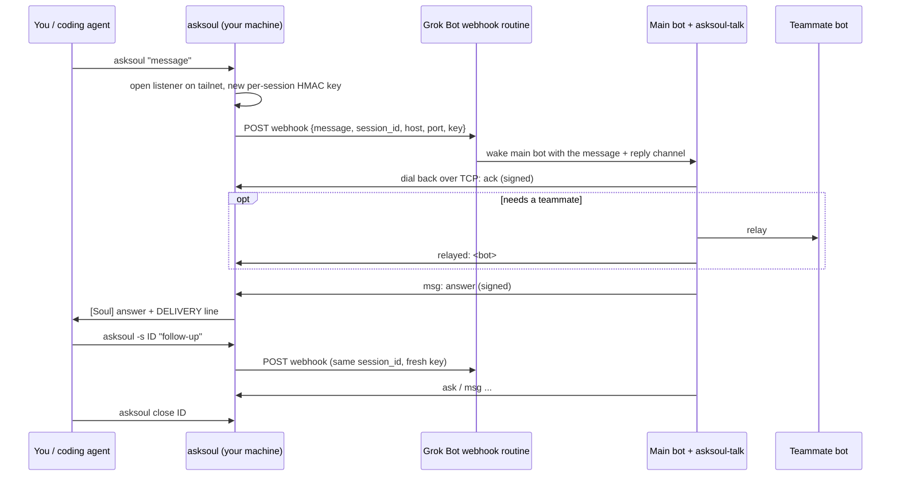

# AskSoul: talk to your Grok Bot team's main bot from the terminal

**Why "AskSoul"?** Soul is the name of my main bot. I love it, so I named the tool after it. If your main bot goes by another name, that's fine: it's still the soul of your team.

---

AskSoul is a small command-line tool that lets you, or a coding agent running on your machine, **ask your Grok Bot team's main bot a question and wait for the answer**, right from a terminal.

```console
$ asksoul "Can you ask the designer bot for a logo draft by tonight?"
asksoul: session 7f3c2a (continue with -s 7f3c2a)
# relayed: Designer (by Soul)
[Soul] Handed it to Designer. I'll ping you when the draft is in.
DELIVERY relayed
```

> **Status:** AskSoul is being extracted from a private, single-team setup. This README describes the target design; the code is being brought in line with it. Expect rough edges until the first tagged release.

## Why

Most "talk to a bot" integrations are fire-and-forget: you send a notification and hope someone reads it. AskSoul is **ask-and-wait**:

- You get a real answer back in the same terminal, not just "message sent".
- Delivery is explicit. You can tell *received* apart from *handed to a teammate bot* and from *answered*.
- Conversations are multi-turn. Keep talking under the same session ID, from a script or interactively.
- It is scriptable. Clear exit codes and an optional JSON status line make it safe to call from **coding agents** (Claude Code, Codex, Cursor, Grok Build, ...) as well as from humans.

If you only need to *inform* and expect no reply, a shared notes file or a plain notification is a better fit. AskSoul is for when you need an answer.

## Features

- **One-shot ask:** `asksoul "message"` prints the bot's answer and exits.
- **Multi-turn sessions:** continue with `-s <ID>`, read later replies with `wait <ID>`, end with `close <ID>`.
- **Interactive TUI:** `asksoul tui` opens a minimal chat window (status bar, transcript, input box). A TUI session is always a continuous conversation.
- **Three delivery layers:** `ack` (the main bot picked it up), `relayed` (handed to a teammate bot), and the bot's actual answer.
- **Late replies are kept:** anything that arrives after a turn ends is buffered by a background session daemon for the next `wait`.
- **Bot-side outbox:** if the bot can't reach you, its frames are queued and delivered on the next dial-back.
- **Signed transport:** every frame is HMAC-signed with a per-session key.
- **No dependencies:** pure Python 3 standard library, on both sides.

## How it works

Grok Bot can start a routine from a **webhook trigger**. AskSoul uses that to wake your main bot, and gives the bot a private way to call you back.



1. The CLI starts a listener reachable only on your private network (Tailscale by default), generates a fresh HMAC key, and POSTs the message plus the reply channel `(host, port, key)` and `session_id` to your webhook.
2. Grok Bot wakes your main bot with that payload.
3. The bot replies with the helper `asksoul-talk`, which dials back and sends **line-delimited JSON frames**, each signed with the key: `ack`, `status`, `msg`, `relayed`, `close`.
4. The CLI prints the answer, keeps the session open in a background daemon, and returns.

## Requirements

- **Your machine:** Python 3.9+ on macOS or Linux.
- **Bot's computer:** Python 3.9+ (the Grok Bot box is fine).
- **Network:** the bot's computer must be able to open a TCP connection to your machine. [Tailscale](https://tailscale.com) is the default and recommended transport. Any private network where the bot can reach you works.
- **Grok Bot:** a routine with a webhook trigger on your main bot.

## Quick start

### 1. Install the CLI

```sh
curl -fsSL https://raw.githubusercontent.com/<owner>/asksoul/main/asksoul -o ~/.local/bin/asksoul
chmod +x ~/.local/bin/asksoul
asksoul --version
```

### 2. Create the webhook routine in Grok Bot

Ask your main bot to create a routine with a **webhook trigger**, using the prompt from [`examples/routine-prompt.md`](examples/routine-prompt.md) (summarized in [Bot side](#bot-side)). Copy the webhook URL and its secret.

### 3. Put the helper on the bot's computer

Ask your main bot to install `asksoul-talk`:

```sh
curl -fsSL https://raw.githubusercontent.com/<owner>/asksoul/main/asksoul-talk -o ~/bin/asksoul-talk
chmod +x ~/bin/asksoul-talk
```

### 4. Configure

Run `asksoul init`, or create `~/.config/asksoul/config.toml`:

```toml
bot_name    = "Soul"                          # your main bot's name, shown as [Soul]
who         = "alice-laptop"                  # how you appear to the bot
webhook_url = "https://..."                   # from step 2
# webhook secret: keep it out of this file if you can
webhook_secret_cmd = "security find-generic-password -s asksoul -w"

[transport]
kind  = "tailscale"                           # or "static"
# host = "100.x.y.z"                          # for kind = "static"
allow = ["100.64.0.0/10"]                     # peers allowed to dial back
```

Environment variables override the file: `ASKSOUL_WEBHOOK_URL`, `ASKSOUL_WEBHOOK_SECRET`, `ASKSOUL_BOT_NAME`, `ASKSOUL_WHO`.

### 5. Say hello

```sh
asksoul --wait 180 "Hi! Just testing AskSoul."
```

The first reply can take a minute or more, because the bot has to be woken up. Set timeouts in minutes, not seconds.

## Usage

```text
asksoul [-s ID] [-w WHO] [-t SEC] [--wait SEC] [--json] [--] MESSAGE
asksoul wait ID [--wait SEC]     read the next answer without saying anything
asksoul close ID                 end the conversation
asksoul ls                       list open conversations
asksoul tui [-s ID] [-w WHO]     interactive chat
asksoul init                     write a config file
asksoul -h | --version
```

| Option | Meaning |
|---|---|
| `-s, --session ID` | Continue or name a conversation. Omit it to get a fresh ID on stderr. |
| `-w, --who WHO` | Your name for this call. |
| `-t, --timeout SEC` | How long the conversation may stay silent before it ends (default 300). |
| `--wait SEC` | How long this call waits for an answer. |
| `--json` | Also print the delivery status as a JSON line: `{"delivery":"ack"}`. |

Need to send a message that is literally `ls` or `tui`? Use `asksoul -- ls`.

Watch out for shell expansion: backticks, `$` and `!` inside double quotes get expanded before `asksoul` sees them. Use single quotes.

### Output

```text
[Soul] text                       the bot said this
[Soul, queued 2026-10-09 21:15]   said earlier, delivered late
# ack (by Soul)                   the bot received your line
# relayed: Designer (by Soul)     handed to a teammate bot (not proof they read it)
DELIVERY ack|relayed|unconfirmed  machine-readable status, end of the turn
```

Treat the whole stdout of one call as one answer. Diagnostics go to stderr.

### Exit codes

| Code | Meaning |
|---|---|
| 0 | Got an answer (session still open), or `close` done |
| 1 | Usage error, unknown session, or Ctrl-C (the conversation goes on) |
| 2 | Webhook unreachable; message **not** delivered and not kept |
| 3 | Session ended by silence timeout |
| 4 | Setup error (network, bind, allowlist, crypto) |
| 5 | Too many bad signatures; start a new session |
| 6 | Relayed to a teammate bot. Done; **don't resend** |
| 7 | The bot closed the conversation |
| 8 | `--wait` ran out with nothing yet; `wait ID` keeps waiting |
| 9 | Only an ack arrived; `wait ID` keeps waiting |

### For coding agents

Paste `asksoul -h` into your agent's instructions. The rules that matter:

- Read the exit code from the call itself, not from a pipe.
- Never resend after exit 3, 6, 8 or 9. Use `wait ID` instead.
- Close the session when the exchange is done, not when the first line arrives.

## Bot side

The webhook routine's prompt tells the main bot how to answer. In short:

- **Dial back with this webhook's own triple.** `host`, `port` and `key` come from the payload that woke you. Never reuse a key from an earlier webhook, even under the same `session_id`.
- **Hold the conversation with `ask`.** When you end with a question, or the caller is interactive (the TUI sends `sender_type = "user-tui"`), use `asksoul-talk ask` so the caller's next line comes straight back to you.
- **Close only at the end.** Send `close` when the conversation is truly over, never after every reply.
- **Report relays.** If you hand the message to a teammate bot, send `asksoul-talk relayed --bot NAME` so the caller knows it was routed and doesn't resend.
- **Sign as yourself.** Teammate bots replying directly pass `--from TheirName`.

```sh
asksoul-talk ask     --host H --port P --key-b64 K --session ID --wait 300 --body 'Which color?'
asksoul-talk send    --host H --port P --key-b64 K --session ID --body 'Done.'
asksoul-talk relayed --host H --port P --key-b64 K --session ID --bot Designer
asksoul-talk close   --host H --port P --key-b64 K --session ID
asksoul-talk outbox                     # list frames queued for undelivered sessions
```

If a dial-back fails, the frames go to a local outbox and are sent first on the next successful dial.

## Security model

- **A fresh key per webhook.** Each request carries a new random HMAC key. Every frame is signed as `HMAC(key, from + "\n" + body)`. Unsigned or mis-signed frames are dropped, and three bad ones in a row end the session.
- **The key is never written to disk.** It lives in the CLI's memory and in the single webhook payload.
- **Private network only.** The listener binds to your tailnet address and only accepts peers on an allowlist. Nothing is exposed to the public internet.
- **No secrets in chat.** The webhook secret stays in your config, keychain or environment. Don't paste it into messages to the bot.
- **The webhook secret is the root of trust.** Anyone who has it can wake your bot. Rotate it in Grok Bot if it leaks.

## Protocol

Frames are line-delimited JSON over TCP: `ack`, `status`, `msg`, `relayed`, `close`, each with `session_id`, `from`, `body` and `mac`. Full specification: [PROTOCOL.md](PROTOCOL.md) (coming soon).

## Roadmap

- [ ] Extract and generalize the code from the private setup
- [ ] `asksoul init` and the config file
- [ ] Example routine prompt and PROTOCOL.md
- [ ] TUI: cursor movement, input history
- [ ] Transports other than Tailscale
- [ ] Packaging (`pipx`, Homebrew)

## Contributing

Issues and PRs are welcome. Please keep both scripts dependency-free (standard library only).

## License

MIT (placeholder; see `LICENSE`).
